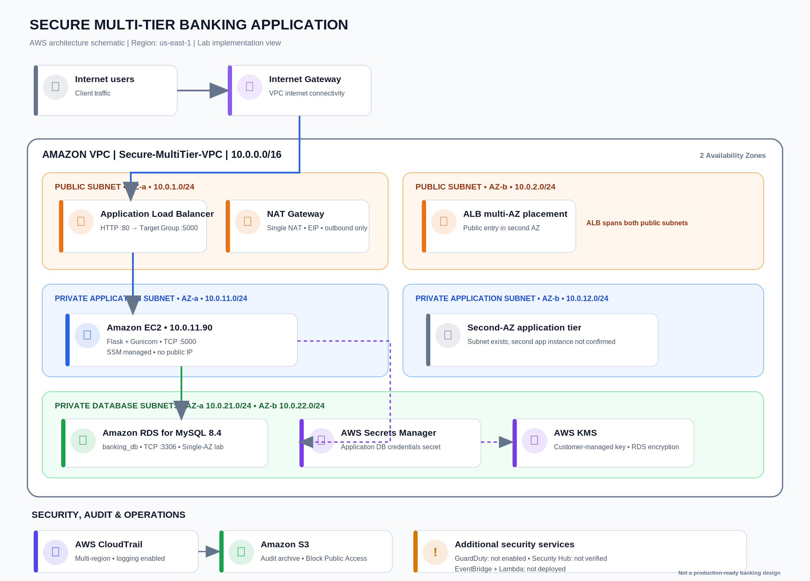

# Secure Multi-Tier Banking Application with AWS Security Monitoring

A hands-on AWS learning project demonstrating network segmentation, private application and database tiers, least-privilege secrets access, encryption at rest, and centralized audit logging.



**Architecture sources:** [Editable Draw.io](architecture/aws-banking-architecture.drawio) · [SVG](architecture/aws-banking-architecture.svg) · [Mermaid](architecture/aws-banking-architecture.mmd)

## Project objectives

- Design a segmented Amazon VPC with public, private application, and private database subnets.
- Expose the application through an internet-facing Application Load Balancer while keeping EC2 and RDS private.
- Administer the EC2 instance through AWS Systems Manager rather than a public SSH endpoint.
- Retrieve application database credentials from AWS Secrets Manager using a narrowly scoped EC2 IAM role.
- Encrypt RDS storage with AWS KMS.
- Centralize AWS API activity logs with a multi-region CloudTrail trail and a private S3 destination.
- Document validation evidence, known gaps, and safe resource cleanup.

## Deployed lab topology

| Layer | Resource | Configuration |
|---|---|---|
| Network | VPC | `10.0.0.0/16`, `us-east-1`, two Availability Zones |
| Public | Subnets | `10.0.1.0/24`, `10.0.2.0/24` |
| Application | Private subnets | `10.0.11.0/24`, `10.0.12.0/24` |
| Database | Private subnets | `10.0.21.0/24`, `10.0.22.0/24` |
| Ingress | Application Load Balancer | HTTP :80 → target group TCP :5000 |
| Compute | EC2 | Private address `10.0.11.90`, Flask/Gunicorn, SSM-managed |
| Database | RDS for MySQL | MySQL 8.4, `banking_db`, TCP :3306 |
| Secrets | Secrets Manager | Application DB credentials |
| Encryption | AWS KMS | Customer-managed key for RDS storage |
| Audit | CloudTrail + S3 | Multi-region trail, log validation, S3 Block Public Access, SSE-S3 |

**Cost-aware lab choices:** one NAT Gateway and a Single-AZ RDS deployment. The second AZ has subnet/network placement but does not mean the application and database are deployed redundantly across both AZs.

## Security implementation status

- **Implemented and tested:** private EC2 administration through SSM; application secret retrieval allowed for the application role; master RDS secret retrieval denied to that role; RDS encryption; CloudTrail configured; S3 Block Public Access and SSE-S3.
- **Not enabled:** GuardDuty could not be enabled because the AWS account required a service subscription.
- **Not verified:** Security Hub.
- **Not deployed:** EventBridge and Lambda incident-response automation. The Lambda file is reference code only.
- **Not independently confirmed:** successful delivery of non-empty CloudTrail log objects at the time of validation.

See [implementation and validation](docs/implementation-and-validation.md) for evidence and limitations.

## Repository structure

```text
.
├── README.md
├── architecture/
│   ├── aws-banking-architecture.drawio
│   ├── aws-banking-architecture.svg
│   ├── aws-banking-architecture.png
│   ├── aws-banking-architecture.mmd
│   └── solution-schematic.dot
├── application/
│   └── README.md
├── docs/
│   ├── implementation-and-validation.md
│   ├── security-controls.md
│   └── cleanup-guide.md
├── lambda/
│   └── incident_response.py
└── scripts/
    └── validation-checklist.md
```

## Important security notice

This is a demonstration environment, **not a production banking system**. It uses HTTP without TLS, demo data, and has no end-user authentication. Do not store real customer or financial data in it. Before any production adaptation, add HTTPS, user authentication and authorization, managed secrets rotation, multi-AZ resilience, monitoring/alerting, backups, and a formal security review.

## Architecture editing

Open `architecture/aws-banking-architecture.drawio` with [diagrams.net](https://app.diagrams.net/). The Draw.io file is editable. The PNG is intended for GitHub preview; the SVG is a scalable vector export.
